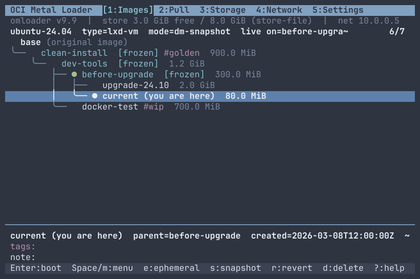

# Interactive terminal UI (`omloader tui`)

The loader boots into a keyboard-only terminal UI. The whole CLI keeps working unchanged; the TUI calls the same library code
(`internal/snapmgr`, `snapshot`, `boot`, `fetch`/`simplestreams`/`cache`, `config`) and never shells out to `omloader`.

```
omloader tui [-c omloader.yaml] [--images-root DIR] [--snap-root DIR] [--data-root DIR] [--ascii]
```



*Simulated render of the real TUI with sample data (`make screenshots`).*

## Screens and keys

Tabs: `1` Images, `2` Pull, `3` Storage, `4` Network, `5` Settings (also Tab / Shift+Tab). Always: `?` / `F1` full-screen help (all keys
per screen, the current screen's page first, scrollable), `S` shell, `P` reboot / power off, `q` or `Esc` on the first screen = leave to
the shell, `Ctrl+L` redraw. **Ctrl+C cancels the running operation and never quits the TUI.** Navigation: arrows or `j`/`k`,
PgUp/PgDn, Home/End, Enter, Esc. UI text: English only, all strings live in `internal/tui/strings.go` (`Strings` / `L`) for later
translation (there is no zh table yet).

### Screen layout (80x24 and larger)

```
row 0      tabs                         [1:Images] 2:Pull ...
row 1      header: omloader <version> | store <free> free / <total> (store-file|partition) | images used | net <IP> [offline]
rows 2..   body (lists show a scroll bar in the last column; the position "3/296" is on the status row / catalog title)
row H-2    status message: green = ok, yellow = warning, red = error
row H-1    key bar: the keys valid in the current context (screen, catalog search, running / finished operation, dialog, form, help)
```

The header is refreshed on tab changes, after operations and every 5 s (statfs of the snapshot store and the images partition,
local IPv4 addresses, offline policy; no directory walks, no network access). On narrow terminals the images-used and then the
store part are dropped first. The version is `main.version` (`-ldflags "-X main.version=..."`, default `dev`).

### Look, colours and terminals

Frames use thin rounded box drawing (`╭╮╰╯─│`), the tab row is a coloured title block with the active tab highlighted, selection is one
accent bar, secondary text (sizes, tree lines, header) is dim. The palette is a dark Nord-like one and degrades with the terminal:

| Detected (`DetectTheme`) | Look |
|---|---|
| `COLORTERM=truecolor`/`24bit` (not `TERM=linux`) | 24-bit palette with dark background |
| `TERM=*256color` | the same palette mapped to xterm-256 |
| `TERM=linux` (Linux console), `xterm`, other | 16 colours, default background; reverse-video selection, blue title block; **Linux console only uses CP437/Terminus-safe glyphs** (light box drawing `┌┐└┘─│├`, `█`; marks `*`, `OK`, `X`, ASCII spinner - no `●`, `✔`, braille or rounded corners) |
| `TERM=vt*`/`dumb`, no UTF-8 locale, `--ascii` | no colour (bold / reverse only) and plain ASCII frames (`+-|`) |

Snapshot tree: `base` bold, the live state and the snapshot it sits on green, frozen snapshots cyan, ephemeral orange/yellow, `#tags`
magenta, sizes / tree lines dim, missing layer red. Errors red, success green, warnings yellow.
Wide (CJK) characters take two cells (width-aware padding, truncation, wrapping and cell continuation), so columns stay aligned.

Layouts: 80x24 is the reference. From 100 columns the lists use wider columns (image names, catalog spec up to 60 cells); from **110 columns** the
image detail shows the node info (parent, created, size, tags, note) as a side panel on the right and the tree uses the full height.

### Console font and resolution (tty1 / VNC / physical screen)

The loader ships `kbd` and a Terminus subset (`Uni3-Terminus[Bold]` 16, 20x10, 24x12, 28x14, 32x16 in `/usr/share/consolefonts`, SIL OFL; `kbd` +2.0 MB installed
≈ +0.8 MB compressed in the squashfs, fonts 80 KB, plus 2.3 MB on the ISO for GRUB's `unicode.pf2`: ISO ≈ +3.2 MB in total). `omloader-console.service` (before sysinit/getty/autoboot, only when a
framebuffer `/sys/class/graphics/fb0` exists; serial consoles are never touched) runs `console-font.sh apply`: it reads the framebuffer size and
loads **the largest bold Terminus font that still gives >= 100 columns x 30 rows** (else >= 80x24, else the 8x16 one) on tty1-6 and switches the
VTs to UTF-8 (`ESC % G`, `kbd_mode -u`); `tui-launch.sh` re-applies it on tty1 and exports `LC_CTYPE=C.UTF-8` so the TUI draws Unicode frames.

| Framebuffer | Font | Console |
|---|---|---|
| 3840x2160 / 1920x1080 | TerminusBold32x16 | 240x67 / 120x33 |
| 1600x900 | TerminusBold28x14 | 114x32 |
| 1366x768, 1280x800, 1280x720 | TerminusBold24x12 | 113x32, 106x33, 106x30 |
| 1024x768 | TerminusBold20x10 | 102x38 |
| 800x600 | TerminusBold16 (8x16) | 100x37 |

Override: kernel argument `omloader.font=NAME` (a file in `/usr/share/consolefonts` without `.psf.gz`, `auto`, or `default` = keep the kernel font), or
`font=NAME` in `<VTOYDATA|OMLOADER>/omloader/console.conf` (read after the data partitions are mounted, i.e. by `tui-launch.sh`). Boot messages
before this unit runs (kernel, stage 1) still use the kernel's built-in font. Local test of the size rule: `test/console-font-test.sh`; remote screenshot of the loader at a given resolution: `test/look-screenshot.sh 1920x1080` (virtio-vga + qemu `screendump`).

GRUB (UEFI): `grub.cfg` sets `gfxmode=1920x1080,1600x900,1366x768,1280x800,1280x720,1024x768,auto`, `gfxpayload=keep` (the Linux console keeps the GOP mode,
efifb/simpledrm), `terminal_output serial gfxterm` (serial stays active, so the serial-first test boots are unchanged) with a dark background and
`vt.default_utf8=1` on the kernel line. Override: `omloader.gfx=WxH` (or `off` = no graphics) in `omloader_args` (the `extra.cfg` mechanism of the
test scripts), or the GRUB submenu **Display resolution** (1920x1080, 1280x720, 1024x768, 800x600, text mode; reloads the menu). Under Ventoy
(GRUB2 mode) none of this runs: Ventoy owns the display. **The reachable maximum is whatever the firmware's GOP offers**: OVMF defaults to
800x600 (1280x800 with some builds; more through the QEMU display device `-device virtio-vga,xres=1920,yres=1080` / OVMF's setup menu), real hardware
normally offers its native mode in the list. If a requested mode does not exist GRUB falls back along the list to `auto`.

### Operations

Long operations (pull, export, flatten, verify, store create/grow, source test, network probe) open an operation view:
title + state, a **progress bar with percentage, bytes, speed and ETA** when the size is known (pull: size of the partial files in
the cache), otherwise a spinner with the elapsed time, and the streamed log below. When the operation ends a **fixed result panel**
stays (`OK SUCCESS` / `X FAILED` / `CANCELLED`, elapsed time, error text); `Enter`/`Esc` dismiss it, `l` shows/hides the log,
Up/Down/PgUp/PgDn/Home/End scroll it. `Ctrl+C` cancels.

### Confirmations

Destructive actions state the consequence before `Enter/y`: **revert** ("the current live state ... will be DISCARDED and cannot be
recovered"; the "keep as snapshot" variant saves it first), **delete** (snapshot and layer size removed permanently; the merge into the
child, or the dm-snapshot refusal with the flatten hint, is shown), **prune / GC** (dry-run list, layers removed permanently; GC only
removes ephemeral leftovers), **store create / grow** (grow releases the store: reboot afterwards), power, shell.

| Screen | What it does |
|---|---|
| Images | name, type (`lxd-vm` / `lxd-container` / `oci (exp.)`), base size, base sha state (`ok`/`MISMATCH`/`-`), snapshot count, current snapshot, last use. **`Enter` boots the image immediately** (continues `current`, no submenu, no confirmation); the image booted last is preselected (`boot.remember_last`). `o`/`→` open the snapshot tree, `e` boots a throwaway copy (ephemeral), `Space`/`m` open the action menu (boot current / throwaway / open tree / dry-run preview), `r` refresh |
| Image detail | snapshot **tree**: root `base (original image)`, snapshots by label (`[frozen]`, tags, on-disk size), the live state as `● current (you are here)`, ephemeral leftovers as `(ephemeral boot)`; the selection starts on `current` (or the last booted snapshot); the info pane/side panel shows parent/created/size/tags/note. **One-key flow** — `Enter` on `current` (or on the snapshot the live state sits on) boots at once; `Enter` on another frozen snapshot or `base` **reverts the live state to it and boots**; `e` ephemeral boot of the selected state (read-only snapshot / base / throwaway current); `s` create snapshot (one prompt, default label `snap-YYYYMMDD-HHMM`, `Enter` accepts); `r` revert without booting; `d` delete (consequence dialog: merge into the child, or the dm-snapshot refusal with the flatten hint; extra confirmation when the live state is inside the subtree); `Space`/`m` (or `Alt+Enter` / `Ctrl+Enter` where the terminal delivers them: `ESC CR`, `CSI 13;5u`, `CSI 27;5;13~`) the action menu with everything else: boot options, dry-run preview, revert, snapshot, tag, note, delete, flatten, export, prune/GC, verify, details; the shortcuts `t` tag, `n` note, `p` prune/GC, `f` flatten, `x` export, `v` verify, `R` reload stay |
| Pull | configured sources (policy shown; from `sources.yaml`, [docs/sources.md](sources.md)), `m` = cycle the mirror of the selected source (official, auto, tuna, nju, ...; shown as `mirror: X`, used by the catalog load and the pull), `t` = `source test` with timings per mirror, Enter loads the catalog (`images list` backend). **Live search**: once the catalog is shown, just type — letters, digits and space go into the search box (`Search: arch vm_`), the list filters on every key: case-insensitive, every word must be a substring of os, release, variant, arch, type (`vm`/`container`) or `lxc:os/release/variant` (e.g. `arch`, `arch vm`, `debian 12 cloud`); exact/prefix matches first; `N of M` match count; the selection stays on the same image while it still matches. Backspace edits, `Esc` clears the search (a second `Esc` returns to the sources), Up/Down/PgUp/PgDn/Home/End move (position `3/296` + scroll bar), `Enter` opens the pull form of the selected image; while the box has the keyboard use Tab / Shift+Tab to change tab and `F1` for help. `/` in the source list jumps to the search box. Same matcher as `omloader images list --search ...` (`internal/imgsearch`). Pull: name, confirm, background pull with progress bar, speed, ETA, sha256 verification line and the result panel. Offline / policy settings are honoured (`policy.allow_online`, `cache.offline`, `allowed_sources`) |
| Storage | snapshot store: partition or store file (host fs, size, allocated, ext4 clean/dirty, attached), free space, space guard (`snapshot.retention.min_free_percent`); `c` create / grow store-file wizard (reuses `snapmgr` store code) |
| Network | like `omloader net status` (`r` refresh, `t` also probes the sources) |
| Settings | resolved config with the source layer of every key (read-only, like `config show --resolved`) |

### Reverting on Enter (the one dialog)

Reverting (`Enter` on a frozen snapshot or `base`, and `r`) throws the live state away, so it asks **once** — and only when there is something to lose:

```
 WARNING: Revert -> a
 Booting a reverts the live state to it: the current state (1.0 KiB written since b) will be LOST.
 Tip: press K to save the current state as a snapshot first, then revert.
 [Enter/y] Revert  [K] Snapshot first  [Esc/n] Cancel
```

`Enter`/`y` reverts (the current state is discarded) and boots, `K` asks for a snapshot label (default `snap-YYYYMMDD-HHMM`, `Enter` accepts),
creates that snapshot and then reverts and boots, `Esc`/`n` cancels. If the live state has **no changes** — the image was never booted, or the live
layer is created lazily at the next boot (the tree shows only the placeholder) — there is nothing to lose and the revert+boot runs without a dialog.
Booting `current`, ephemeral boots (`e`, the menu) and booting the image from the list never ask. Delete, prune/GC and store operations keep their
consequence confirmations. Limit: the dialog reports the size written to the live layer, not a file count; "has changes" means the live layer exists.

### Auto-boot countdown and "last booted"

With `boot.default_image` set (boot.yaml on the data partition, see INSTALL.md) `autoboot.sh` counts down `boot.timeout` seconds before the TUI starts and prints
`Booting '<image>' (<snapshot>) in N s -- press any key for the menu` on tty1 and the serial console; **any key** opens the TUI instead (or the shell with `boot.ui: shell`).
`boot.default_snapshot` (`current` | `base` | label; labels/base are throwaway boots) selects what boots. With `boot.remember_last: true` (default) every boot from
the TUI writes `<data>/omloader/last-boot` (image, snapshot, `ephemeral`), preselects it next time and `boot.default_image: last` auto-boots that image's `current`.

### Boot handoff

**Snapshots are created, reverted and deleted from the loader (CLI/TUI) before the image is booted; a running system cannot be snapshotted or reverted — shut it down, return to the loader, then manage snapshots (hot snapshots are not supported).**
Booting *current* (Enter) continues the live state (no new layer per boot); booting a snapshot or base is an ephemeral boot (`--snapshot <label>` / `--ephemeral`): nothing is kept and the snapshot is never modified.
The action menu's *Preview the boot command* streams a **dry-run** (`omloader boot --dry-run`); there is no boot confirmation. Right after the key press the TUI restores
the terminal and runs `runBoot` in the foreground, i.e. **exactly the code path of `omloader boot`**: VM = dm-snapshot + kexec
(never returns), container = mounts the root and writes `/run/omloader-switch`, then `omloader tui` exits 0 and
`switch-root.sh` (the code formerly inline in `autoboot.sh`) runs `systemctl switch-root`. If the boot fails the error is printed and the TUI comes back after Enter.
A lock (`/run/omloader/boot.lock`) stops a second console from booting at the same time.

## Launch design (decision)

* `autoboot.sh` (omloader-autoboot.service, before the gettys) decides the console UI once and writes `/run/omloader/ui`
  (`tui` or `shell`) and, when a boot config file was found, its path to `/run/omloader/uicfg`:
  `omloader.ui=tui|shell` kernel flag > `boot.ui` of `<VTOYDATA|OMLOADER>/omloader/boot.yaml` (or `omloader.yaml`) > default `tui`.
  `omloader.image=`, `omloader.hook=1`, `omloader.selftest=1` always force `shell` (the e2e suites are unaffected).
* The existing autologin getties stay (tty1 and ttyS0). The login shell's `/etc/profile.d/omloader-banner.sh` sources
  `tui-launch.sh` on tty1 / ttyS* / hvc0 when `/run/omloader/ui` says `tui`: it runs `omloader tui` in the foreground of that
  console, then does the container switch-root if requested, otherwise falls through to the shell banner. **Leaving the shell
  (`exit`) makes getty log in again, which shows the TUI again.** Both consoles run an independent TUI at the same time.
* With `boot.default_image` the countdown is unchanged; Enter/any key cancels it and the TUI opens (instead of a bare shell).
* Exit codes of `omloader tui`: 0 quit / boot prepared, 10 shell requested.
* Marker: `OMLOADER_TUI_READY uptime=N` is printed to the console right before the first frame (boot timing; e2e-live).

## Terminals

Raw ANSI renderer (no terminfo/curses): cursor addressing, SGR reverse/bold and 16 / 256 / 24-bit colours (see *Look, colours and terminals*); works on `TERM=linux` (tty1),
`vt100`/`vt220`/`xterm` serial consoles. Minimum 80x24 (serial consoles report no window size: 80x24 is assumed, or `COLUMNS`/`LINES`,
SIGWINCH is honoured when the tty reports a size). UTF-8 box drawing / tree glyphs only when the locale is UTF-8 and `TERM` is not
`vt*`; otherwise (and always with `--ascii`) plain ASCII (rounded frames only off the Linux console). Colours are off for `vt100`/`dumb`; selection is reverse video or the accent bar. Navigation
keys can be rebound with `OMLOADER_TUI_KEYS="down=n,m;up=w"` (actions: up down pgup pgdn home end select back next prev help cancel redraw).

## Code layout

* `internal/tui`: `theme.go` (colour depth detection, palette, glyph sets), `Model` (state + `Update(Key)` + `View() *Canvas`, no IO), `Service` interface (everything the model needs),
  `Op` (background operations with streamed output, cancel), `Terminal` (raw mode, key reader, diff renderer), `strings.go`.
* `cmd/omloader/tui.go`: the real `Service` (library calls; `streamRunner` echoes commands and stops between commands on cancel) and the boot handoff.
* Tests: `go test ./internal/tui` (navigation, tree, flows with a fake `Service`, live search, header/bars, progress/ETA, result panel, help, CJK alignment, colour fallback, 80x24 golden frames in `internal/tui/testdata` (`UPDATE_GOLDEN=1` refreshes), key parsing, keymap, pty tests with
  a mini VT emulator), remote `make e2e-tui` (`test/e2e-tui.sh`, `test/tui-drive.py`: QEMU serial on a pty).

## Dependencies / licenses

No third-party libraries were added (custom renderer, standard library + `syscall` ioctls); the binary grew by ~0.35 MB
(12.9 MB -> 13.3 MB static, CGO_ENABLED=0). Existing dependency: `gopkg.in/yaml.v3` (MIT / Apache-2.0).

## Limits

* Cancelling flatten/export/store operations takes effect between the external commands (the Runner API has no context); pull and probes cancel immediately.
* Pull progress is the size of partial files in the cache (no per-mirror line; the mirror that served the file is only visible through retry/fallback warnings).
* The two consoles do not synchronise their views (refresh with `r`); only booting is locked.
* VM boot from the TUI is the same `omloader boot` path (kexec) but the e2e only boots a container from the TUI; the VM path stays covered by `make e2e`/`e2e-pull`.
* Grow releases (unmounts) the store file; reboot afterwards.
* A real serial terminal larger than 80x24 is used as 80x24.
* The header's "images used" is the used space of the images partition (statfs), not the sum of image sizes. The speed/ETA of the progress bar needs a known total: only pull has one, other operations show a spinner.
* While the catalog search box has focus, single-letter shortcuts (`1`-`5`, `s`, `P`, `r`, ...) are text; use Tab/Shift+Tab, `F1`, `Esc`.
* Wide characters are measured with a built-in width table (CJK, fullwidth, common emoji), not wcwidth of the terminal.
